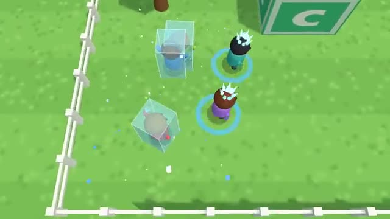

# Freeze Tag

Get tagged, freeze. Touch a friend to thaw them. A multiplayer starter game from [Multiplayer Agent](https://multiplayeragent.com): 3D, party, 3–10 players, with bots that fill empty seats.

## How it plays

Taggers freeze every runner they touch. Frozen runners wait in a block of ice until a free teammate stands next to them for a second. If anyone is still free when the clock runs out, the runners win; freeze them all and the taggers do.

**Controls:** WASD or hold the mouse to run, Space to dash, or the touch stick and Dash button.

## Make it yours in the Game Builder

Open the [Game Builder](https://multiplayeragent.com), choose **Start from a starter game** and pick Freeze Tag. It opens as version 1 in your studio, ready to play and publish. Then ask for changes, for example:

- Make it a snowball fight in a winter park
- Add a power-up that makes you invisible for 3 seconds
- Let the last runner standing get a golden crown

## Run it yourself

1. Get a free publishable key (`pk_…`) at [multiplayeragent.com](https://multiplayeragent.com).
2. In `index.html`, put it in place of `pk_REPLACE_ME` in the `MP_CONNECT` block.
3. Serve the folder (for example `npx serve`) and open it. The 3D engine loads as a module, which browsers block from a file on disk.

Without a key it still runs, offline against bots.

## How it is built

- One `index.html` plus three.js in `libs/`. The comment at the top of the script maps the code and explains the multiplayer.
- **Host-run rounds:** The host's browser picks the taggers, decides every freeze and thaw and keeps the score; if it leaves, the next player takes over.
- **Bots:** Bot taggers chase and bot runners flee and thaw their friends until enough people join.
- **Live sync:** Every runner, tagger and ice block is the same for everyone.
- **Leaderboard:** The most points anyone scored in one round.
- `?attract` runs it offline with bots only. The preview video is recorded from it.

## License

MIT. three.js in `libs/` is MIT too (Copyright 2010-2024 three.js authors).
